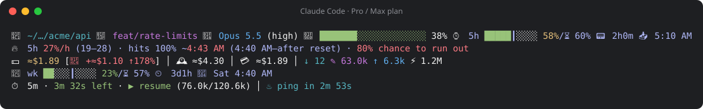
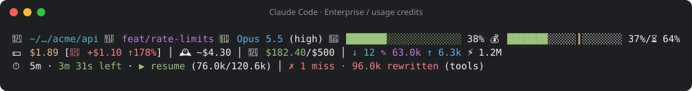

# cc-hud

A cost-aware status line for [Claude Code](https://claude.com/claude-code): what you're spending, how fast you're burning through your plan, when you'll hit the limit, and whether your prompt cache is still warm.

**Pro / Max plan:** 5-hour and weekly windows, with a burn-rate forecast



**Enterprise, or any plan with usage credits:** month-to-date spend against your limit, paced against the month



The demo images are rendered from the real script; see [Demo](#demo).

## What it shows

| Row | Segments |
|---|---|
| 1 | 📁 directory · 🌿 git branch · 🤖 model (effort) · 🎨 output style · 🧠 context used · ⌚ 5h window **or** 💰 month budget |
| 🔥 | 5h burn rate (range) · when it hits 100% · chance you run out before the reset *(Pro/Max/Free)* |
| 2 | 💵 session cost · 📄 what this prompt added, with ↑/↓ when it's a spike · 🕰️ today · 📅 month · ↓ fresh in ✎ cache write ↑ out ⚡ cache read |
| 📅 wk | weekly window: used, ⏲️ time left, 🔄 reset time *(Pro/Max/Free)* |
| 3 | ⏱️ cache TTL countdown or **cold** · ▶ resume / ◐ quick only / ↻ new session · ♨ [cache-warm](#cache-warm) keep-alive · ✗ cache misses |

Rows only appear when they have something to say. Every glyph is explained by:

```sh
bash cc-hud.sh --legend
```

**How to read the bars.** The fill is how much you've used, and the ┃ tick is how far through the period you are (the month, the 5-hour window, the week). Fill left of the tick means you're under pace and it stays green; fill past the tick means you'll run out before the reset and it turns red. The month counts **working days only**, so a quiet weekend doesn't look like falling behind.

**Resume or restart?** Row 3 compares the cost of carrying on in this session (every request re-reads the whole context) with starting fresh from your notes. ▶ means keep going, ◐ means fine for a quick follow-up but not a full task, ↻ means a new session is cheaper. The numbers in brackets are your context and the point where the answer changes.

## Install

Requires `bash`, `jq` and `curl`. Works on Linux and macOS.

1. Clone it anywhere:

   ```sh
   git clone https://github.com/esoterik-dev/cc-hud.git ~/.local/share/cc-hud
   ```

2. Point Claude Code at it in `~/.claude/settings.json`:

   ```json
   {
     "statusLine": {
       "type": "command",
       "command": "bash ~/.local/share/cc-hud/cc-hud.sh",
       "refreshInterval": 10
     }
   }
   ```

   `refreshInterval` re-runs the script while you're idle, so the countdowns (cache TTL, time left in a window) keep moving. Without it the line only updates when something happens in the session.

3. Optionally, copy the example config:

   ```sh
   cp ~/.local/share/cc-hud/cc-hud.conf.example ~/.claude/statusline.conf
   ```

To update, `git -C ~/.local/share/cc-hud pull`.

## Configure

Set options as environment variables, or as `KEY=value` lines in `~/.claude/statusline.conf`. Environment variables win. The file is read as plain text, never run as a script, and only the keys below are accepted.

| Key | Default | Effect |
|---|---|---|
| `STATUSLINE_THEME` | from `COLORFGBG`, else `light` | `dark` or `light`: readable muted text and red for your background |
| `STATUSLINE_EMOJI` | `1` | `0` uses plain text glyphs instead of emoji |
| `BUDGET_BAR_STYLE` | `marker` | `marker`, `banded`, `dual` or `off` |
| `BUDGET_BAR_LINE` | `1` | Which row the month budget bar sits on: `1`, `2` or `3` |
| `BUDGET_BAR_WIDTH` | `20` | Bar width in cells (minimum 6) |
| `DAILY_COST` | `1` | `0` hides today's spend |
| `PROMPT_DELTA` | `1` | `0` hides the per-prompt cost |
| `PROMPT_DELTA_SPIKE` | `25` | ±% from the recent average before ↑/↓ shows |
| `PROMPT_DELTA_WINDOW` | `5` | How many recent prompts make the average |
| `STATUSLINE_CACHE_TTL` | `1` | `0` hides the cache TTL |
| `STATUSLINE_VERDICT` | `1` | `0` hides resume / restart |
| `STATUSLINE_CACHE_MISSES` | `1` | `0` hides the cache-miss counter |
| `STATUSLINE_CACHE_WARM` | `1` | `0` hides the cache-warm segment |
| `STATUSLINE_GLYPH_*` | | Replace a glyph: `IN`, `OUT`, `CACHE`, `WRITE`, `PROMPT`, `TTL`, `DAY` |

The resume/restart verdict has its own tuning keys (`STATUSLINE_FRESH_CTX`, `STATUSLINE_RESTART_COST_5M`, `STATUSLINE_RESTART_COST_1H`, `STATUSLINE_BURST_QUICK`, `STATUSLINE_BURST_TASK`); `--legend` describes them.

## Where the numbers come from

Each figure says how far to trust it: `$` is official, `~$` is a local estimate, `≈$` is what plan usage would cost at API list prices (not what you pay).

1. **`GET /api/oauth/usage`** — month-to-date spend and the 5-hour and weekly windows, from the same source as `/usage` in Claude Code. It covers every device and product, not just this machine. The script calls it in the background at most once every 5 minutes, so a render never waits on the network.
2. **The JSON Claude Code passes on stdin** — context window, model, session cost, rate limits, prompt cache state.
3. **Your session transcript** — the token breakdown and prompt count.

`/api/oauth/usage` is an undocumented endpoint that Claude Code itself calls, so its fields may change between Claude Code releases. When it's unreachable, the month figure falls back to a local estimate marked `~`.

## Privacy

- To call the usage endpoint, the script reads your Claude Code OAuth token from `~/.claude/.credentials.json` (on macOS, from the Keychain). The token is sent only to `api.anthropic.com` and never written anywhere.
- Everything else stays local: small cache files under `~/.claude/` (`.usage-*`, `.monthly-cost-*`, `.session-costs/`, `.prompt-costs/`, `.token-cache/`, and `.cold-block/` for the cache hook). Per-prompt and per-day files are pruned after one to two weeks; the rest stay until you delete them.

## cache-warm

If you run the claude-cache-warm plugin (keep-alive pings that stop an idle session's prompt cache from expiring), row 3 shows what it is doing: the countdown to the next ping and how many it has sent since you were last active, or "stopped after N (cap)" once it gives up. Without the plugin the segment stays hidden.

## Cache hooks (optional)

Two small hooks in `hooks/` stop the two common ways a session pays to re-write its whole prompt cache. They work with or without cache-warm and need only `bash` and `jq`.

**`question-guard.sh`: don't move on without an answer.** Claude Code can close an unanswered question after a while (`askUserQuestionTimeout`). It then tells Claude to *"proceed using your best judgment"*. With this hook, Claude stops instead: it restates what is still open in plain text, keeps any answers you did give, and ends its turn. Ending the turn also lets a keep-alive like cache-warm keep the cache warm while you're away. An open question blocks the keep-alive, because Claude Code holds it back until you answer.

**`cold-cache-block.sh`: warn before a cold re-write.** When the prompt cache has expired (5 minutes or 1 hour after the last response, depending on the session), your next message is held back with a note like this:

```
Prompt cache expired 7m ago (5m cache). Sending this would re-write about 150.0k tokens of context at full price.
Cheaper: start a new session (/clear, or a new claude) and pick up from your progress notes.
Your message is back in the input box: press Enter within 30 seconds to send it here anyway.
```

Claude Code puts the blocked message back in the input box, so pressing Enter within 30 seconds sends it anyway (any resend of the same text in that window goes through). Keep-alive pings, background-task reports, slash commands, a session's first message, the first message after a compaction and `claude -p` runs are never blocked.

To turn them on, add this to `~/.claude/settings.json` (merge with any `hooks` you already have):

```json
{
  "askUserQuestionTimeout": "60s",
  "hooks": {
    "PostToolUse": [
      { "matcher": "AskUserQuestion",
        "hooks": [{ "type": "command", "command": "bash ~/.local/share/cc-hud/hooks/question-guard.sh" }] }
    ],
    "UserPromptSubmit": [
      { "hooks": [{ "type": "command", "command": "bash ~/.local/share/cc-hud/hooks/cold-cache-block.sh" }] }
    ]
  }
}
```

`askUserQuestionTimeout` accepts `"60s"`, `"5m"`, `"10m"` or `"never"` (the default), and it's also under **Question auto-continue timeout** in `/config`. Use `60s` if you want the cache kept warm. `5m` closes the question just as a 5-minute cache expires.

## Troubleshooting

**The status line is blank.** Run the script by hand with a minimal input and look at what it prints:

```sh
echo '{"workspace":{"current_dir":"'"$PWD"'"},"model":{"display_name":"test"}}' | bash cc-hud.sh
```

`jq: command not found` means jq isn't installed. Claude Code shows nothing when the command fails, and the script is written to always exit 0, so a blank line usually means a missing dependency or a wrong path in `settings.json`.

**Odd characters or misaligned rows.** Your terminal's font may render emoji at an unexpected width. Set `STATUSLINE_EMOJI=0` for plain text glyphs. On narrow terminals rows wrap between segments; that needs a UTF-8 locale (`LANG=en_US.UTF-8` or similar).

**No 5h / week rows.** These only appear on plans with usage limits (Pro, Max, Free) once Claude Code or the usage endpoint reports them.

## Development

```sh
bash tests/run.sh           # all tests
bash tests/run.sh cache     # only tests whose name contains "cache"
```

The tests run the real script and hooks exactly as Claude Code does — JSON on stdin, output on stdout — in a throwaway `$HOME`, with `curl` and the macOS `security` command replaced by fakes in `tests/bin/`. Nothing touches your own `~/.claude`. CI runs them on Linux and macOS.

### Demo

```sh
bash demo/render.sh          # regenerate demo/*.svg
bash demo/render.sh --print  # show the demo sessions in your terminal
```

## License

[MIT](LICENSE)
